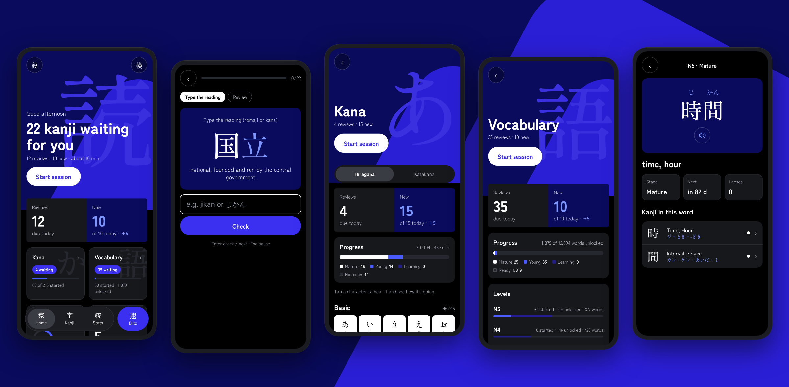

<div align="center">

# Kanjiskole <sub>漢字学校</sub>

**Learn to read Japanese.** Kanji inside real words, kana and vocabulary, on a spaced-repetition schedule that
starts from what you already know.

[](https://github.com/Lena-LSG/Kanjiskole/actions/workflows/ci.yml)
[](https://github.com/Lena-LSG/Kanjiskole/releases/latest)
[](LICENSE)




**[Download the Android app](https://github.com/Lena-LSG/Kanjiskole/releases/latest)** · [What's new](CHANGELOG.md) · [Credits](CREDITS.md)

</div>

Kanjiskole is for learners whose Japanese is ahead of their reading: you calibrate the kanji you can already read,
and from then on every new kanji is taught inside words made only of kanji you know. Wrong answers are mistakes you
might really make (the other reading, a look-alike kanji, a dropped long vowel), and every answer explains why the
right one is right. The interface is in Danish or English. Everything stays on your device: no account, no
tracking, no AI calls.

## What it does

- **Kanji**: calibrate what you know, then daily sessions. Words are i+1 (only kanji you know plus the new one),
  the order is JLPT N5 → N1 with components first, and every answer has a "Why?" that explains why the right one
  is right. Kanji pages show readings, words, stroke order and your own mnemonic.
- **Kana**: hiragana and katakana with the full chart coloured by progress, look-alike drills (シ/ツ) and listening.
- **Vocabulary**: a word unlocks when you know all its kanji, so the word list grows out of what you can read
  (12,894 words, by JLPT level, searchable, each with its own page).
- **Audio**: native-speaker recordings from Kanji alive for 4,497 words (fetched once, then offline) and the
  device's Japanese voice for the rest.
- **Blitz**: 60 seconds against your record. **Stats**: accuracy, streak, stages, weakest cards and leeches per track.
- Five extra new cards beyond the daily allowance in every track. A full JSON export, so your data is never locked in.

## Install

- **Android**: download `kanjiskole-vX.Y.Z.apk` from the [latest release](https://github.com/Lena-LSG/Kanjiskole/releases/latest)
  and open it (allow installs from your browser once). Compare it with the `.sha256` next to it if you like.
  Updates install over the old version and keep your progress.
- **Web**: the release also has the web build (`-web.zip`), a static site you can host anywhere; or run it locally
  with `npm run web`.

For audio, install a Japanese text-to-speech voice on the phone (Settings → Text-to-speech). Native-speaker
recordings cover the 4,497 most common words either way.

## Privacy

Progress is stored only on the device (SQLite on Android, IndexedDB in the browser) and leaves it only when you
export it. The app's one network request is for pronunciation recordings from Kanji alive, downloaded the first
time a word is played; on the web, fonts come from Google Fonts. Android permissions: internet only. Details:
[SECURITY.md](SECURITY.md).

## Repository

| Path | What |
|---|---|
| `app/` | The Expo app (SDK 58, expo-router). Screens in `app/src/app/`, building blocks in `app/src/components/` |
| `packages/core/` | All the learning logic: FSRS (ts-fsrs), curriculum, exercises, distractors, sessions, stats. No UI, fully tested |
| `scripts/data/` | The reproducible data build from hash-pinned sources. Output in `assets/data/` (never edit by hand) |
| `scripts/` | Supply-chain checks: `audit.ts`, `check-native-dupes.ts`, `notices.ts` |
| `docs/` | `DECISIONS.md` (what changed and why), `ROADMAP.md`, `SECURITY-REVIEW.md`, `DEV-SETUP.md`, the original `HANDOVER.md` and prototype |

## Development

Node 22 (see `.nvmrc`). Setting up a Windows machine from scratch: `docs/DEV-SETUP.md`.

```sh
npm ci
npm test               # Vitest, in Europe/Copenhagen time
npm run typecheck
npm run lint           # ESLint: typescript-eslint (type-aware) and the React hooks rules
npm run audit          # npm audit, with explicit and expiring exceptions
npm run check:native   # native modules: one version each, all matching the Expo SDK, no Expo Modules v2
npm run notices        # regenerate THIRD-PARTY-NOTICES.md from what actually ships
npm run data           # fetch the pinned sources and rebuild assets/data
npm run web            # dev server
npm run build:web      # static export to app/dist
```

Android APKs are built with EAS from `app/`: `npx eas-cli@latest build -p android --profile preview`. CI runs
every check above on every push, plus both bundles, the data build and a REUSE licence lint.

## Releases

Put the notes, with the EAS APK link, in `docs/releases/vX.Y.Z.md`, then push the tag `vX.Y.Z` or run the Release
workflow by hand with that version (it creates the tag). It checks the version against `app.json` and publishes the
notes, the APK with its SHA-256 and the web build on GitHub. History: `CHANGELOG.md`.

## Contributing

Issues and pull requests are welcome; see [CONTRIBUTING.md](CONTRIBUTING.md) and the
[Code of Conduct](CODE_OF_CONDUCT.md).

## Licence

Kanjiskole is free software: you can redistribute it and/or modify it under the terms of the
[GNU General Public License v3](LICENSE).

The dictionary data is derived from the EDRDG's JMdict, KANJIDIC2, RADKFILE and KRADFILE and is shared under
CC BY-SA 4.0; stroke order is from KanjiVG (CC BY-SA 3.0); the recordings are from Kanji alive (CC BY 4.0). Who
made what: [`CREDITS.md`](CREDITS.md). The open-source packages inside the app and their licences:
[`THIRD-PARTY-NOTICES.md`](THIRD-PARTY-NOTICES.md). Per-file licensing follows the [REUSE](https://reuse.software)
specification (`REUSE.toml`, `LICENSES/`).
